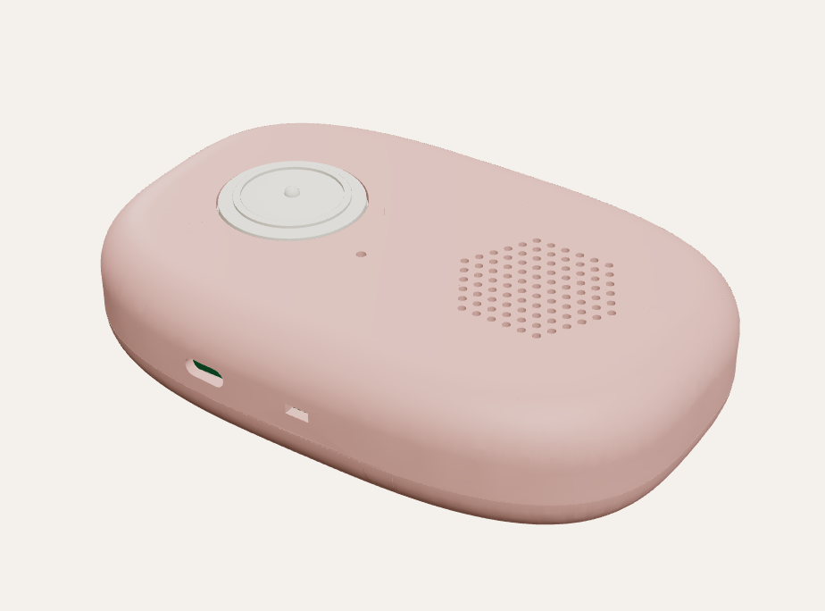

# Readable enclosure

Two-part pebble shell, 128 × 84 × 30 mm, modelled around the real component
STEP files in this folder. Fully parametric: `readable_enclosure.py`.



## Files

| File | What it is |
| --- | --- |
| `out/front.stl`, `out/back.stl` | The two shell halves, ready to slice |
| `out/cap_scan.stl` | Large Scan button cap (raised ring + centre dot) |
| `out/cap_repeat.stl`, `cap_vol_up`, `cap_vol_down`, `cap_lang` | Side button caps |
| `out/camera_bezel.stl` | Charcoal camera island over the lens and the illumination LED |
| `out/camera_window.step` | Outline of the clear window for laser cutting (0.8 mm acrylic) |
| `out/*.step` | Same parts as STEP, for Rhino / Fusion |
| `out/readable_assembly.step` | Shells, caps and simple parts placed together (the vendor board models are left out to keep it small; see `components()` in the script for where each goes) |
| `readable_enclosure.py` | The parametric model, with an interference check |
| `renders/` | Images of the current design |

Regenerate after changing any parameter:

```
pip install cadquery trimesh rtree
python3 design_enclosure/readable_enclosure.py
```

It rebuilds the parts, checks every component, cap and shell for collisions,
and exports to `out/`. The current design reports no interference.

## Layout

Back face (z = 0) faces the page; the front face carries the controls.

- **Front:** large Scan button (30 mm, over the cell), speaker grille (over the
  carrier board), status LED.
- **+Y side:** four 8 mm side buttons, told apart by touch:
  Repeat (round), Volume + (raised dot), Volume − (raised bar), Language (square).
- **−Y side:** USB-C charging port, power slide switch.
- **Back:** a charcoal camera island (like a phone's) covering the lens and the
  white illumination LED behind one clear window; six vents under the CM5; five screw holes.
- **−X end:** lanyard slot with an internal post to tie the cord around.

Inside, back to front: Camera Module 3 and PowerBoost on standoffs; CM5 under
the CM5-NANO-B carrier on M2.5 standoffs, SoC facing the vents; LiPo cell over
the camera and PowerBoost; scan switch in a tube over the cell; speaker in a
ring over the carrier; amplifier beside the speaker.

## Printing

- Material: PETG (heat from the CM5; PLA softens around 55 °C). ASA also works.
- Front shell: print **face down** (front face on the bed). Back shell: print
  **back face down**. No supports needed for either, apart from the side-button
  holes, which bridge fine at 8 mm.
- 0.2 mm layers, 4 walls (the 2.2 mm walls are then solid), 20 % infill.
- Button caps: **TPU, Shore 85A–95A** (soft rubber feel; the flange also seals
  out dust). Print slowly (~20 mm/s), top face down, 100 % infill.
- Camera island: black PETG, outer face down.
- Camera window: laser-cut from 0.8 mm clear acrylic (use `camera_window.step`
  as the outline), glued into the island with a thin bead of clear UV glue.

## Hardware

| Item | Qty |
| --- | --- |
| M2.5 × 10 mm screws (pan or button head) | 5 |
| M2.5 heat-set inserts, OD 3.5–4.0 mm, 4–5 mm long | 5 |
| M2.5 × 8 screws + 1.5 mm spacers for the CM5 / carrier stack | 4 |
| M2 × 5 self-tapping screws (camera, PowerBoost) | 8 |
| 12 × 12 × 4.3 mm tactile switch (Scan) | 1 |
| 6 × 6 × 5 mm tactile switches (side buttons) | 4 |
| SS12D00 mini slide switch | 1 |
| USB-C panel breakout, ≤ 12 × 12 mm | 1 |
| 3 mm LED (status), 5 mm white LED (illumination) | 1 + 1 |
| 40 mm 4 Ω 3 W speaker, ≤ 6 mm deep | 1 |
| 0.8 mm clear acrylic (camera window) | 1 |
| LiPo cell, ≤ 50 × 50 × 9 mm | 1 |
| Foam tape for the cell | |

Wiring: `../docs/WIRING.md`.

## Assembly

1. Press the heat-set inserts into the five front-shell bosses (soldering iron, ~230 °C).
2. Back shell: glue the window into the camera island and press the island into
   its pocket on the back face. Screw the camera (lens through the square opening)
   and PowerBoost onto their standoffs; push the 5 mm LED into its hole from inside and glue.
3. Mount the CM5 on the carrier, then the stack onto the four CM5 standoffs.
4. Front shell: drop the caps into their holes from inside, then fit the
   switches behind them (Scan switch on the tube floor, side switches in their
   holders, glued with a drop of CA). Glue the speaker into its ring, fit the
   USB-C breakout and slide switch into their cradles, the status LED into its tube.
5. Wire per `docs/WIRING.md`. Stick the cell over the camera / PowerBoost with foam tape.
6. Close: the lip on the front shell locates in the back shell; five M2.5 × 10 screws from the back.

## Outdoor version (optional, not yet modelled)

An optional 4G variant for people without home Wi-Fi or for use outside (pharmacy,
doctor, supermarket): a 4G LTE modem with a nano-SIM slot on the −Y side.
The standard version stays Wi-Fi only. Before modelling it, pick the modem board
(size, power draw) and a power board that can supply its peaks.

## Check before printing the final version

- **Cell size.** The model uses a 50 × 50 × 9 mm cell (~3000 mAh class). If
  yours differs, change `BATT` and rerun: the check will say if it no longer fits.
- **Speaker depth.** Modelled at 40 mm × 6 mm. A deeper speaker hits the
  carrier's GPIO header: change `SPK` and rerun.
- **CM5-NANO-B mounting holes.** The model assumes the carrier's holes line up
  with the CM5's (standard 48 × 33 mm pattern). Confirm on the real board.
- **Wires over the GPIO header** must leave the header sideways (solder to the
  pins or use right-angle housings): there is ~3 mm between the header and the speaker.
