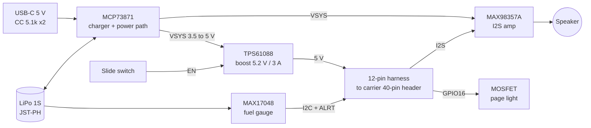

# Readable IO board (custom PCB, rev A spec)

A small 2-layer board that replaces the hand-wired power and audio modules.
It does **not** replace the CM5 carrier: the Waveshare CM5-NANO-B stays, because
a custom CM5 carrier (fine-pitch DF40 connectors, MIPI camera lanes, 4+ layers)
costs more to get right than it saves at our volumes. See "Cost" below.

Status: specification. Schematic and layout come next; the enclosure gets a CAD
pass once the board outline is fixed.

## What it replaces

| Today (modules, hand-wired) | On the IO board |
| --- | --- |
| Adafruit PowerBoost 1000C (charger + 5 V boost, **1 A**) | MCP73871 charger with power path + TPS61088 boost, **5.2 V at 3 A** |
| MAX98357A breakout | MAX98357A chip |
| USB-C panel breakout + wires | USB-C receptacle on the board edge |
| Slide switch on a cradle + wires | Right-angle slide switch on the board edge |
| NPN + resistors for the page light | MOSFET driver on board |
| BAT85 diode on the low-battery line | Not needed: the fuel gauge alert is 3.3 V safe |
| No battery percentage | MAX17048 fuel gauge: "Battery 74 percent" on request |

The camera, buttons, status LED and speaker stay as they are.

## Block diagram



Design choices, and why:

- **Charger + boost as two chips, not a one-chip power-bank IC.** The PowerBoost
  1000C uses the same MCP73871 charger, so charging, power path and
  "runs while charging" behave the way the current prototype already does. The
  one-chip IP5306 is cheaper (about $0.35) but needs a button press to start its
  output and turns itself off at light load. That is workable, but the behaviour
  would have to be tested first. The two-chip version costs about $3 more per board.
- **3 A boost.** The PowerBoost's 1 A rating is the main brown-out risk today.
  The CM5 alone can draw around 1.5 to 2 A in bursts. We have not measured
  Readable's peak current yet: do that on prototype #1 (USB power meter, a few
  scans, `vcgencmd get_throttled`) before fixing the boost's current-limit resistor.
- **Amplifier on the battery side (VSYS), not on 5 V.** This takes up to ~0.6 A of
  speaker peaks off the boost. At battery voltage the MAX98357A gives about 1.5 W
  into 4 Ω, which is plenty for speech in a handheld.
- **Fuel gauge instead of a low-voltage pin.** Battery percentage can be spoken,
  and the warning comes at 10 % instead of at a fixed voltage.
- **No 4G, no extra sensors, no microcontroller.** The 4G "outdoor version" uses
  a separate USB module and does not change this board.

## Connections

### Harness to the CM5-NANO-B 40-pin header

One 12-pin JST-SH (1.0 mm) on the IO board, a pre-crimped harness ending in single
2.54 mm housings on the header pins, leaving sideways (the speaker sits ~3 mm
above the header).

| IO board pin | Signal | GPIO (BCM) | Header pin |
| --- | --- | --- | --- |
| 1, 2 | 5 V out | | 2, 4 |
| 3, 4 | GND | | 6, 9 |
| 5 | I2C SDA (fuel gauge) | 2 | 3 |
| 6 | I2C SCL (fuel gauge) | 3 | 5 |
| 7 | I2S BCLK | 18 | 12 |
| 8 | I2S LRCLK | 19 | 35 |
| 9 | I2S DIN | 21 | 40 |
| 10 | Page light enable | 16 | 36 |
| 11 | Fuel-gauge alert (open drain, spare) | 26 | 37 |
| 12 | GND | | 39 |

Buttons and the status LED still wire straight to the header (pins 11, 13, 15,
16, 18 and 22, see `WIRING.md`); they sit in the front shell, far from this board.

### On-board connectors

| Connector | Type |
| --- | --- |
| Battery | JST-PH 2.0, 2-pin (matches the cells on the parts list) |
| Speaker | JST-SH 1.0, 2-pin |
| Page-light LED (back face) | JST-SH 1.0, 2-pin |
| USB-C | 16-pin receptacle, power only (CC pull-downs, no data) |
| Power | Right-angle slide switch, on the same edge as USB-C |

## Bill of materials (rev A, per board)

Prices from LCSC where we could check them; the rest are estimates to confirm
when the BOM is uploaded to JLCPCB.

| Part | LCSC | Price | Checked |
| --- | --- | --- | --- |
| MCP73871T-2CCI/ML charger, QFN-20 | C511310 | $1.26 | yes |
| TPS61088RHLR boost, VQFN-20 | C87357 | ~$2.00 | no |
| MAX98357AETE+T amplifier, TQFN-16 | C910544 | $0.81 | yes |
| MAX17048G+T10 fuel gauge, DFN-8 | C2682616 | ~$1.50 | no |
| Boost inductor 1.0 to 2.2 µH, Isat ≥ 7 A | tbd | ~$0.40 | no |
| USB-C 16-pin receptacle | tbd | ~$0.20 | no |
| Right-angle slide switch | tbd | ~$0.10 | no |
| JST-PH / JST-SH connectors (4) | tbd | ~$0.40 | no |
| AO3400 MOSFET, resistors, capacitors | basic parts | ~$0.60 | no |
| **Total** | | **~$7 to 9** | |

Not used on purpose: USB data lines, ESD arrays, battery thermistor (the cells
have their own protection board), test-point headers beyond a few pads.

## Size and placement

Target outline about **36 × 37 mm**, single-sided assembly, in the PowerBoost bay
(under the cell, back shell), with a notch for the screw boss at (−40, −28.5).
USB-C and the slide switch move onto the board's −Y edge, so the enclosure needs
new openings near the back of the −Y wall; the old USB-C and switch cradles and
the amplifier pocket go away. The camera, scan button, speaker and carrier
positions do not change.

## Software

Already in the code (this branch):

- `app/hal/fuel_gauge.py` reads the MAX17048 (charge %, voltage, charge rate).
- **Hold the Language button** to hear the battery level, in Greek or English;
  it adds "charging" while plugged in. The help text mentions it.
- The device says "battery low" at 10 % (checked once a minute while idle,
  repeated at most every 10 minutes).

To enable on the IO board build:

```yaml
hardware:
  buttons:
    low_battery_pin: null   # the fuel gauge handles low battery
  fuel_gauge:
    enabled: true
```

and add `dtparam=i2c_arm=on` to `/boot/firmware/config.txt`. Audio setup
(`dtoverlay=max98357a`) is unchanged.

## Cost

Euro figures include 24 % VAT and are converted at about €0.9 per dollar. JLCPCB
fees are from their PCBA price page: setup $8.18, stencil $1.53, $3.07 per
"extended" part type. We count about 10 extended part types.

| | Modules (today) | IO board |
| --- | --- | --- |
| Parts it replaces, per device | ~€35 (PowerBoost €23, amp €7, USB-C €1.50, small parts ~€3) | |
| First order: 5 assembled boards | | ~€110 to 120 |
| 45 boards (40 devices + 5 spares) | €1,400 for 40 devices | ~€490 to 510 (~€11 per board) |
| One revision, if rev A needs a fix | | ~€110 to 120 |

**For the one prototype: no, it costs more.** About €110 for a batch of boards
instead of €35 of modules, plus 2 to 3 weeks for fabrication and shipping. Build
prototype #1 with the modules on the parts list.

**For the 40 devices in the proposal: yes.** About €1,400 with modules versus
about €600 to 750 with the IO board, including the first batch and one revision.
That saves roughly **€650 to 800**, about €17 to 20 per device. The bigger saving
is assembly time: about 20 hand-soldered wires and two cradles per device go
away, which we estimate at 45 to 60 minutes per unit (not yet timed).

**A full custom CM5 carrier is not worth it at this scale.** It would save the
NANO-B (~€17) and some space, but needs 4+ layers, two fine-pitch DF40 connectors,
impedance-controlled camera lanes and probably two revisions. At 40 units the
savings are roughly cancelled by the revision cost and weeks of design time. It
only makes sense in the hundreds of units.

## Open checks before ordering rev A

1. Measure prototype #1's peak current to set the boost's current limit.
2. Confirm the CM5-NANO-B's mounting holes and header position on the real board
   (also listed in the enclosure README).
3. Choose the exact cell; the board only needs its connector and polarity.
4. Schematic review of the MCP73871 input-current and charge-current resistors
   against the USB-C chargers we expect people to use.
